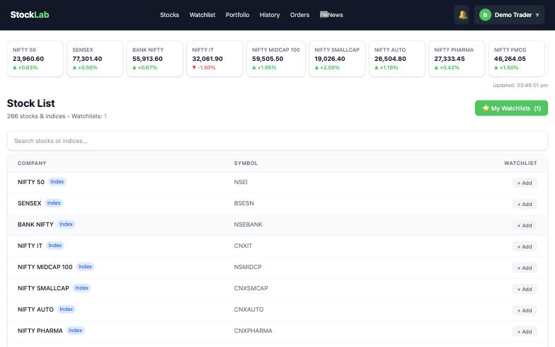
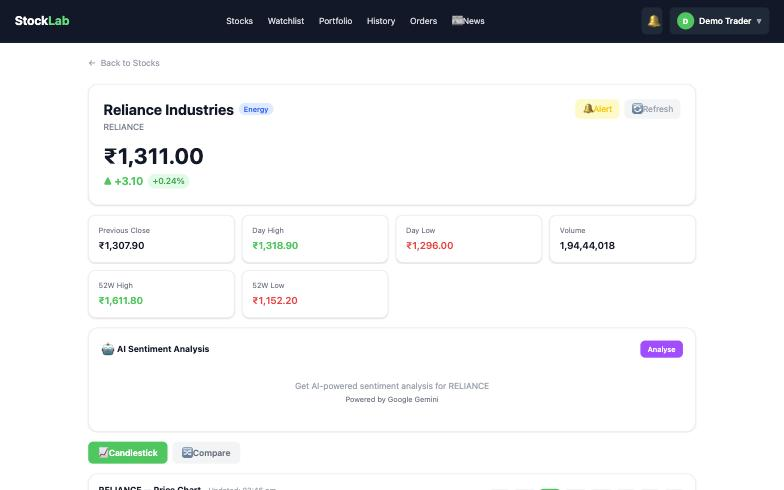
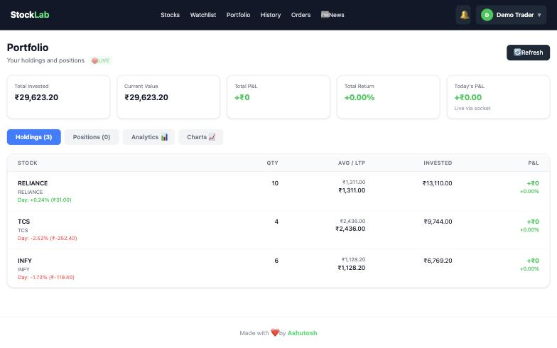
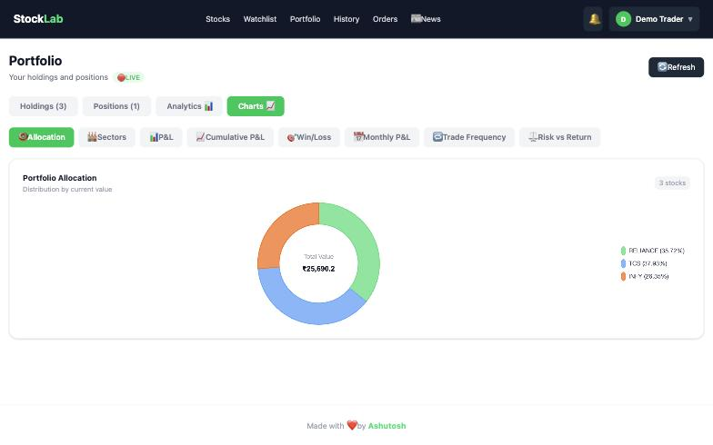
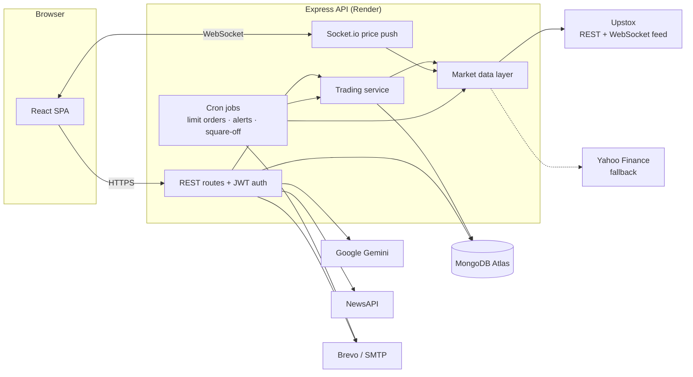

# StockLab — NSE paper trading

StockLab is a paper-trading platform for the Indian stock market. You sign up, get ₹1,00,000 of virtual cash, and buy and sell NSE stocks at live market prices — delivery or intraday, with stop-loss and target orders, price alerts, watchlists and a portfolio analytics page. No real money is involved.

**Live demo:** [paper-trading-eight-zeta.vercel.app](https://paper-trading-eight-zeta.vercel.app) — sign up with any email you can receive an OTP at. The API runs on Render's free tier, so the first request after a quiet spell can take up to a minute.



## Why I built it

I wanted to practise trading Indian stocks without risking money, and I wanted a project that goes beyond CRUD: live prices pushed to the browser, money that has to add up to the paisa, jobs that run on a schedule, and third-party APIs that fail in interesting ways. StockLab is the result.

## What it does

- **Live prices** for about 250 popular NSE stocks and 15 indices (any NSE equity can be found through search), streamed from the Upstox market data feed and pushed to the browser over Socket.io.
- **Delivery and intraday orders.** Intraday uses 5× leverage (20% margin) and open positions are squared off automatically at 15:20 IST, like a real broker.
- **Limit orders** — limit buy, stop loss and target — checked every minute and filled at the market price once triggered.
- **Price alerts and circuit-breaker alerts** by email.
- **Portfolio analytics:** live P&L, XIRR, sector allocation, win rate, monthly P&L, trade frequency and a risk-vs-return chart.
- **Candlestick charts** with SMA/EMA, Bollinger bands, RSI, MACD, Stochastic and OBV, from 1 day to 10 years.
- **AI sentiment** for any stock, generated with Google Gemini.
- Multiple watchlists, per-stock notes, a trade history with CSV/PDF export, market news, and email OTP sign-up with password reset.

| Stock page | Portfolio | Charts |
| --- | --- | --- |
|  |  |  |

## Tech stack

| Layer | Tools |
| --- | --- |
| Frontend | React 19, Vite, Tailwind CSS, React Router, lightweight-charts, Chart.js, Socket.io client |
| Backend | Node.js, Express 5, Mongoose, Socket.io, node-cron, JWT, bcrypt, express-rate-limit |
| Data | MongoDB Atlas |
| Market data | Upstox API (REST + protobuf WebSocket feed), Yahoo Finance as a fallback |
| Other APIs | Google Gemini (sentiment), NewsAPI (news), Brevo or Gmail SMTP (email) |
| Testing | Jest, Supertest, mongodb-memory-server, Vitest, React Testing Library |
| Hosting | Vercel (frontend), Render (API) |

## Architecture



The backend is split so the Express app (`backend/app.js`) can be imported by tests without a database, sockets or cron jobs; `backend/server.js` adds those and starts listening.

## Design decisions

**One trading service for every order.** Market orders and triggered limit orders both go through `backend/services/trading.js`. Before that, the same buy/sell logic lived in two places and drifted apart.

**Money moves with guarded, atomic updates.** A buy debits funds with a single `findOneAndUpdate` that only matches if the balance is big enough, and rounds to two decimals inside MongoDB. Sells decrement shares the same way. Two requests arriving at once can't overspend the balance or sell the same shares twice, and repeated trades don't build up floating-point noise.

**The trading day is IST, not UTC.** Intraday positions, circuit-alert de-duplication and chart dates use India time regardless of the server's timezone. Between midnight and 05:30 IST, UTC is still on the previous day, which used to put trades on the wrong day.

**Intraday positions close themselves.** A cron job squares off open intraday positions at 15:20 IST. Render's free tier sleeps when idle, so positions left over from an earlier day are also closed on startup and on the user's next request — the margin always comes back.

**A market data layer with a fallback.** Controllers ask `backend/marketData` for quotes and candles. It uses Upstox when a token is configured and Yahoo Finance otherwise. Single-quote calls made at the same moment are batched into one Upstox request, and Upstox's instruments file is cached on disk so startup doesn't wait on a slow download.

**Errors that say what went wrong.** Bad input returns 400 with a specific message, an outside service failing returns 502, and unexpected errors return 500 without leaking internals.

## Running it locally

You need Node.js 20+ and a MongoDB connection string (a local MongoDB or a free Atlas cluster).

```bash
git clone git@github.com:<your-github-username>/<repo-name>.git
cd <repo-name>

# API
cd backend
cp .env.example .env    # then fill in the values
npm install
npm run dev             # http://localhost:3000

# Frontend (second terminal)
cd frontend
npm install
npm run dev             # http://localhost:5173
```

Required backend variables are `MONGO_URL` and `TOKEN_KEY`, plus email settings for sign-up OTPs. Without an Upstox token the app falls back to Yahoo Finance prices. `backend/.env.example` lists every option. The frontend calls the API on port 3000 of the same host unless `VITE_API_URL` is set.

## Tests

```bash
cd backend && npm test          # Jest + Supertest
cd frontend && npm test         # Vitest + React Testing Library
```

- **Backend:** 179 tests that go through the real HTTP layer and the real sign-up → email OTP → login flow. Each test file gets its own in-memory MongoDB. The real `.env` is never loaded, email and Gemini are replaced with fakes, and any outbound network request fails the test. Cron jobs are tested by capturing their callbacks and running them; date-dependent code runs against a frozen clock across day, month, quarter and year boundaries. Coverage is about 88% of statements.
- **Frontend:** 41 tests for the indicator maths, XIRR, trade grouping (run in the Asia/Kolkata timezone), the socket service and the auth/theme hooks.

`npm run test:coverage` in either folder prints a coverage report.

## Deployment

The API runs on Render, the frontend on Vercel and the database on MongoDB Atlas, all on free tiers. Step-by-step instructions are in [docs/DEPLOYMENT.md](docs/DEPLOYMENT.md).

## Known issues and next steps

- The JWT is kept in `localStorage`, which an XSS bug could read. An httpOnly cookie would be safer.
- Socket.io connections aren't authenticated. They only carry public price data, but they should still require a token.
- A saved Upstox OAuth token is stored unencrypted in MongoDB. The default setup uses Upstox's read-only analytics token from an environment variable instead.
- On Render's free tier the API sleeps after 15 minutes without traffic, so the first request after that takes around a minute, and scheduled jobs don't run while it's asleep.
- Paper fills happen at the last traded price with no brokerage, taxes or slippage, so returns look better than real trading would.
- A few React effects have incomplete dependency lists (lint warnings). They work today but should be tidied up.
- `eslint-plugin-react-hooks` is pinned to 7.0.1. Version 7.1 adds stricter rules that flag the "fetch in `useEffect`" pattern most pages use; moving data loading to a fetching library (e.g. TanStack Query) would satisfy them.
- Mongoose is pinned to 9.3.1: newer MongoDB driver releases (7.7) fail to connect inside Jest's sandbox ("Missing required sub-document 'driver'"). The app itself is fine on newer versions; the pin keeps the test suite reproducible until that's resolved.
- Next: brokerage and tax estimates, an order book with partial fills, and end-to-end browser tests with Playwright.
